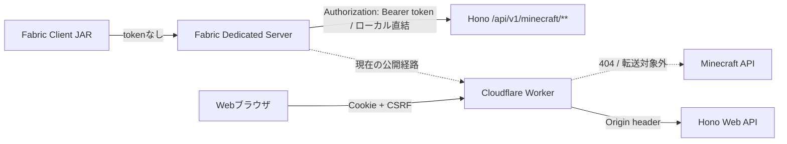
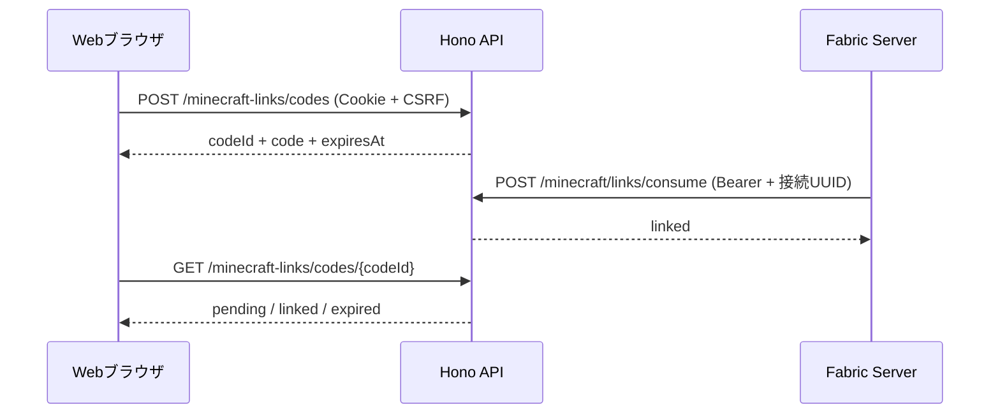
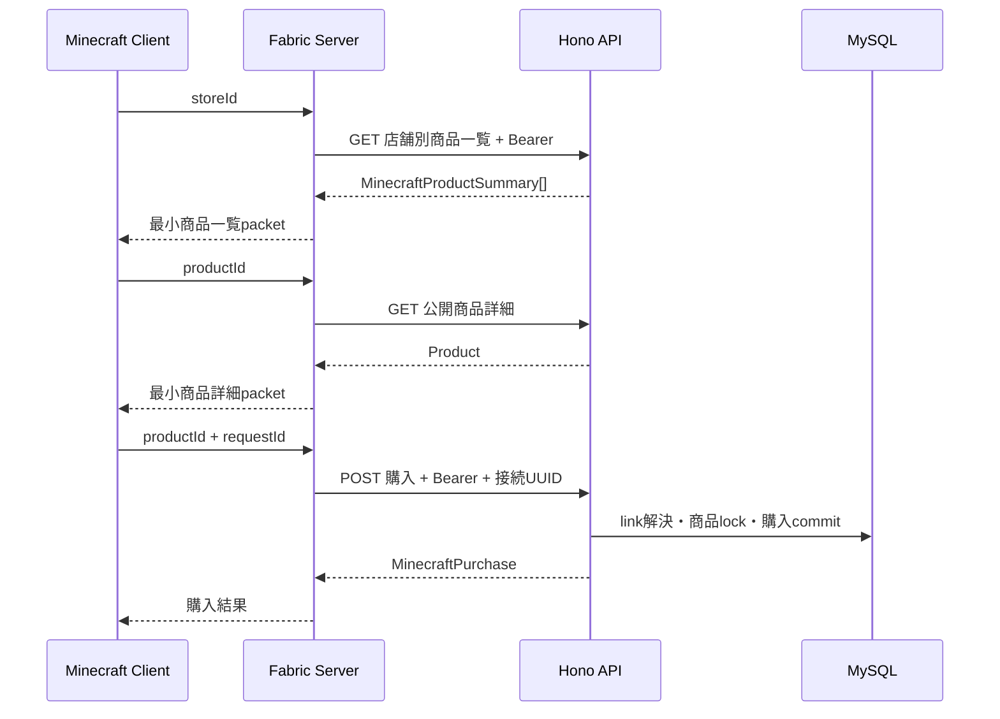

# MineTenant API v1

開発URLは`http://localhost:8787`です。バックエンドはNode.js上のTypeScript / Honoで
動作し、MySQLへデータを保存します。JSONのキーはフロントのTypeScript型に合わせて
camelCaseで返します。

> **契約節の読み方**
> 「現行から確定契約への変更」と「一点物Product」から「Web購入」までの各節は、
> B-CONTRACT-01 / 02で確定した、B-PRODUCT / B-BUY / B-XP / B-BUILD Issueが実装する
> 最終契約です。2026-09-26時点の`develop` (`46235a9`)はB-PRODUCT-01 #49を取込み済みで、
> Product responseは`status`へ移行しました。一方、出品・購入writerは物理`stock`との互換期間中で、
> 店舗pointsも販売店舗だけへ加算するため、後続Issue完了までは一部の動作が異なります。
>
> 「認証とCSRF」はB-CONTRACT-07で確定したusername認証の最終契約です。B-AUTH-01〜12、B-AUTH-SESSION #119、
> B-DB-STRICT-MODE #120、B-AUTH-CONTRACT-CUTOVER #121、Frontend F-AUTH-01の段階移行中は、
> この節の「移行順と互換期間」も参照してください。取引履歴は現行実装の説明です。
> ただし共有serializerが返すProductの形、店舗の成長表示、出品・購入に伴う
> 店舗pointsの加算規則は、どの対象endpointでも本契約へ統一します。
> Fabric専用APIの認証はB-CONTRACT-03で確定し、B-MC-AUTH-01 #62で実装する契約です。
> ローカルでHonoへ直接接続するMinecraft routeにはFabric Dedicated Server認証が必要です。
> 現在の公開モードとFront WorkerではMinecraft routeを公開しません。
> Minecraftの商品閲覧・購入・結果照会はB-CONTRACT-05で確定した最終契約です。実装Issueでは
> 本文のpath、認証境界、DTO、status、error codeを変更せずに接続します。

## 現行から確定契約への変更

| 対象           | 現行`develop`                                        | 確定契約                                                                |
| -------------- | ---------------------------------------------------- | ----------------------------------------------------------------------- |
| Product        | `status: "available" \| "sold"`。物理`stock`は互換用 | 同じresponseを維持し、物理`stock`も削除                                 |
| 一覧・詳細     | `status`を含み売り切れも公開。soft deleteは未接続    | `available` / `sold`を公開し、soft delete済みは除外                     |
| 出品request    | 商品項目 + 必須`stock`。所有者・店舗も送信可能       | `requestId` + 数量なしの商品項目だけ。所有者・店舗・初期状態はAPIが確定 |
| 出品の再送     | 毎回別Productを作成                                  | 同じ利用者・ID・内容は同じProduct。異なる内容は409                      |
| Web購入request | 2つのpathで`buyerId` / `source`も送信可能            | 正規pathは本文`requestId`だけ。互換pathは`productId` + `requestId`だけ  |
| 購入時の状態   | `stock`を1減らし互換triggerが`status`を同期          | `available`から`sold`へ一度だけ変更                                     |
| 店舗points     | 販売店舗へ100 points                                 | 出品店舗へ10、buyer店舗へ50、販売店舗へ100                              |
| 店舗level      | 境界と表示計算が実装に直書き                         | 境界、最大Lv、最大到達後、表示値、丸めを共通契約として固定              |
| Webアカウント  | emailで認証し、`name`を表示                          | `username`で認証し、`displayName`を表示。emailは最終schemaに持たない    |

DBの列・制約・移行規則は[`database.md`](./database.md)を参照してください。

## 目次

- [共通仕様](#共通仕様)
- [店舗ポイント](#店舗ポイント)
- [Web API](#webエンドポイント一覧)
- [認証とCSRF](#認証とcsrf)
- [一点物商品・出品・購入](#一点物product)
- [店舗・取引](#店舗)
- [Webフロント接続例](#webフロントの接続例)
- [Minecraftアカウント連携](#webアカウントとminecraft-uuidの連携)
- [Minecraft商品閲覧・購入](#minecraft商品閲覧購入)

## 共通仕様

- ID: 文字列
- 価格: 日本円の整数
- 日時: ISO 8601
- Content-Type: `application/json`
- 正常時: 通常は`{ "data": ... }`。一覧は配列、詳細はオブジェクト
- CSRF Cookie初期化・ログアウト・商品削除: `204 No Content`、本文なし
- 未ログイン: `401 Unauthorized`
- 所有者・取引関係者以外の操作: `403 Forbidden`
- 入力エラー: `422 Unprocessable Entity`
- データなし: `404 Not Found`
- 在庫切れ・重複など: `409 Conflict`
- CSRFトークン不一致・期限切れ: `419`。Cookieを再取得し、必要なら再ログインする
- ログイン・登録の試行制限: `429 Too Many Requests`
- Web認証: MySQLに保存するCookieセッション
- WebのすべてのPOST・DELETEは、ログイン・登録も含めてCSRF検証の対象
- Minecraft専用APIはFabric Dedicated Server専用のBearer認証を使う
- メッセージ・チャットAPIは作らない

B-CONTRACT-01以後に作る出品・購入の`requestId`はcase-sensitiveな
`[A-Za-z0-9._:-]{1,100}`です。前後空白の除去や大文字小文字変換はせず、UUID v4を推奨します。
各routeは共通の文字列trim後ではなく、受信した未加工の`requestId`を検証します。現行`parseBody`を
使う場合はこのfieldだけtrim対象から外し、空白付きの新規値をtrimして受理せず422にします。

購入だけは、新規ID validationが全routeへ適用される前の旧routeなどですでに保存された形式外IDを、
値変更せず再生するgrandfather規則があります。文字列かつ255文字以下の形式外IDを受けた場合、lookup
時点で同じIDの既存Transactionがありproduct、認証済みbuyer、sourceが一致すれば200、一つでも違えば
409 `REQUEST_ID_CONFLICT`です。既存行がなければ422で、新しいTransactionは作りません。出品requestに
この例外はありません。
業務エラーの`code`はクライアントの分岐用に固定し、`message`の文面では分岐しません。

| Status | code                      | 発生条件                                           |
| ------ | ------------------------- | -------------------------------------------------- |
| 409    | `REQUEST_ID_CONFLICT`     | 同じ出品・購入`requestId`を異なる内容へ再利用      |
| 409    | `LISTING_REQUEST_RETIRED` | soft delete済み商品の出品`requestId`を同内容で再送 |
| 409    | `USER_STORE_NOT_READY`    | 出品・購入に必要な所有店舗が存在しない             |
| 409    | `OUT_OF_STOCK`            | `status='sold'`（legacyの`stock=0`を含む）         |
| 422    | `SELF_PURCHASE`           | 出品者本人が自分の商品を購入                       |

入力不正は現行どおり422の`{ "message", "errors" }`です。商品詳細GETで存在しない商品を指定した
場合は404の`{ "message": "商品が見つかりません。" }`です。上表のエラーは`message`と`code`を必ず返し、
`REQUEST_ID_CONFLICT`と`SELF_PURCHASE`には該当入力の`errors`も返します。

## 店舗ポイント

店舗pointsは次の操作が初回成功したときだけ加算します。購入元がWeb / Minecraftのどちらでも、
加算対象とpointsは同じです。

| 成功操作 | 加算対象                          | 加算points |
| -------- | --------------------------------- | ---------: |
| 新規出品 | Productのsellerが所有する店舗     |         10 |
| 購入成立 | buyerが所有する店舗               |         50 |
| 販売成立 | Productのsellerが所有する販売店舗 |        100 |

上の値はWeb / Minecraftや実行環境によって変えない固定の契約値です。現行の
`STORE_SALE_POINTS`は移行前の互換設定であり、確定契約の100 pointsを上書きする用途には使いません。

新規出品の10 pointsは、`Asia/Tokyo`の暦日（00:00以上、翌日00:00未満）ごとに、各店舗で
初回成功した新規Productの先着3件だけへ加算し、1日最大30 pointsです。4件目以降も出品自体は
成功しますが、pointsは加算しません。日次判定にはProductの`created_at`を使い、DBへUTCで保存した
時刻をJSTの半開区間へ対応させます。

出品後にProductをsoft deleteしても、加算済みpointsは減算せず、その日の3件枠も戻しません。
入力不正、競合、所有店舗なし、存在しない商品、自己購入、売り切れ、またはDB transactionの失敗など、
操作が成立しなかった場合はpointsを加算せず、出品の日次件数にも数えません。

出品・購入とも、同じ内容の同じ`requestId`を再送して既存のProductまたはTransactionを返す場合は、
日付をまたいでもpointsを再加算しません。異なる内容への`requestId`再利用でも加算しません。
Productの作成と出品pointsの加算、ならびにProductの`sold`化、Transactionの作成、buyer店舗への
50 points、販売店舗への100 pointsは、それぞれ一つのDB transactionでcommitします。途中で
失敗した場合は関連する変更をすべてrollbackし、片方の店舗だけへpointsを加算しません。

### 店舗levelとAPI表示値

`points`は0以上の整数で保持する累計値であり、level計算の正本です。最大Lvへ到達してもpointsの
加算は続け、1,000で切り捨てません。`level`はpointsから導出して同じtransactionで保存する値で、
クライアント入力やWeb / Minecraftのsourceによって変更しません。

| level | 必要な累計points | そのlevelのpoints範囲 |
| ----: | ---------------: | --------------------- |
|     1 |                0 | 0〜99                 |
|     2 |              100 | 100〜299              |
|     3 |              300 | 300〜599              |
|     4 |              600 | 600〜999              |
|     5 |            1,000 | 1,000以上             |

最大はLv5です。`level`は「必要な累計pointsが現在値以下である最大のlevel」とします。登録直後は
`points: 0`、`level: 1`です。負数、少数、`NaN`、無限大をlevel計算へ渡して丸めてはいけません。
これらはAPI入力ではなくprogramming errorまたはDB不整合として扱い、保存しません。保存済みの
`points`と`level`が一致しない場合はpointsを正としてlevelを再計算します。

B-XP-01の共通計算はpointsだけを入力とし、`Number.isSafeInteger(points) && points >= 0`を
満たさない値には`RangeError`を送出します。文字列変換、切り捨て、0への丸めは行いません。
GETはpointsから計算した値を返すだけでDBを更新せず、保存levelの修復はmigrationまたは次の
正規なpoints更新transactionで行います。

APIはフロントとMODが再計算しなくてよいよう、次の値を共通計算から返します。

- `level`: 上表から求めた現在level
- `points`: 上限で切り捨てない累計points
- `nextLevelPoints`: 次のlevelまで「あと何pointsか」。最大Lvでは`0`
- `levelProgressPercent`: 現在levelの区間内の進捗率。最大Lvでは`100`
- `maxLevel`: この契約での最大level。常に`5`
- `isMaxLevel`: 現在levelが最大なら`true`。それ以外は`false`

最大Lv以外の進捗率は次の式を使い、小数点以下を切り捨てます。結果は`0〜99`です。

```text
floor((points - 現在levelの必要points) / (次levelの必要points - 現在levelの必要points) * 100)
```

`nextLevelPoints`は`次levelの必要points - points`です。最大Lvでは`level: 5`、`maxLevel: 5`、
`nextLevelPoints: 0`、`levelProgressPercent: 100`、`isMaxLevel: true`を返します。クライアントは
`nextLevelPoints: 0`や最大Lvの数値を独自に判定せず、`isMaxLevel`と`maxLevel`を使います。

#### 境界値の手計算

| points | level | nextLevelPoints | levelProgressPercent | isMaxLevel |
| -----: | ----: | --------------: | -------------------: | :--------- |
|      0 |     1 |             100 |                    0 | false      |
|      1 |     1 |              99 |                    1 | false      |
|     99 |     1 |               1 |                   99 | false      |
|    100 |     2 |             200 |                    0 | false      |
|    101 |     2 |             199 |                    0 | false      |
|    299 |     2 |               1 |                   99 | false      |
|    300 |     3 |             300 |                    0 | false      |
|    301 |     3 |             299 |                    0 | false      |
|    599 |     3 |               1 |                   99 | false      |
|    600 |     4 |             400 |                    0 | false      |
|    601 |     4 |             399 |                    0 | false      |
|    999 |     4 |               1 |                   99 | false      |
|  1,000 |     5 |               0 |                  100 | true       |
|  1,001 |     5 |               0 |                  100 | true       |

#### B-BUILD-03へ渡すlevel変更

初回成功するpoints更新ごとに、対象Storeをlockした後の値を`oldPoints`、加算後を`newPoints`とし、
それぞれから`oldLevel`と`newLevel`を計算します。複数店舗を更新する購入ではStoreごとに別々に
計算します。`oldLevel < newLevel`の結果だけをB-BUILD-03へ渡し、points、level、原因となる
ProductまたはTransaction、後続の建築jobを同じtransactionでcommitできるようにします。1回の加算で
複数境界を越えた場合に作るjobの単位と状態遷移はB-CONTRACT-06を正本とします。

同じ`requestId`の再送、入力不正、競合、rollbackでは新しいlevel変更結果を発生させません。
最大Lv到達後はpointsだけが増え、`oldLevel`と`newLevel`はともに5なのでlevel変更なしです。

ここでいう`level`、`oldLevel`、`newLevel`はpoints由来の論理的な成長levelで、Minecraftのworldへ
適用済みの建築levelではありません。登録時点ですでに`level: 1`なので、初回Lv1建築を
`oldLevel: 0`から`newLevel: 1`への成長として扱いません。建築済みlevelのfield名、Lv1建築、
対応templateがあるtarget levelだけをjob化する規則、Lv1完了前にLv2をclaimしない順序は
B-CONTRACT-06を正本とします。`oldLevel`と`newLevel`は内部serviceの受け渡し値であり、
`StoreGrowth`の公開fieldには含めません。

## Webエンドポイント一覧

ベースURLは`http://localhost:8787/api/v1`です。下表のパスを後ろにつなぎます。
ログイン必須のAPIにはセッションCookieが必要です。公開GETはログイン不要です。

| Method | パス                              | ログイン       | 用途・正常時                                                 |
| ------ | --------------------------------- | -------------- | ------------------------------------------------------------ |
| GET    | `/auth/csrf-cookie`               | 不要           | CSRF Cookie設定、204                                         |
| POST   | `/auth/register`                  | 不要           | ユーザー・所有店舗作成とログイン、201 `data: User`           |
| POST   | `/auth/login`                     | 不要           | ログイン、200 `data: User`                                   |
| GET    | `/auth/me`                        | 必須           | 現在のユーザー、200 `data: User`                             |
| POST   | `/auth/logout`                    | 必須           | セッション破棄、204                                          |
| GET    | `/products`                       | 不要           | 商品一覧・検索・店舗絞り込み、200 `data: Product[]`          |
| GET    | `/products/{productId}`           | 不要           | 商品詳細、200 `data: Product`                                |
| POST   | `/products`                       | 必須           | 本人の店舗へ冪等に出品、初回201・再送200 `data: Product`     |
| DELETE | `/products/{productId}`           | 必須           | 本人の未取引商品の削除、204                                  |
| POST   | `/purchases`                      | 必須           | 本文に商品IDを指定して購入、201または200 `data: Transaction` |
| POST   | `/products/{productId}/purchases` | 必須           | URLに商品IDを指定して購入、201または200 `data: Transaction`  |
| GET    | `/purchases/requests/{requestId}` | 購入者本人のみ | requestIdから購入結果を照会、200 `data: Transaction`         |
| GET    | `/stores/{storeId}`               | 不要           | 公開店舗情報、200 `data: Store`                              |
| GET    | `/stores/{storeId}/growth`        | 不要           | 公開店舗成長情報、200 `data: StoreGrowth`                    |
| GET    | `/stores/{storeId}/dashboard`     | 所有者のみ     | 店舗集計、200 `data: Dashboard`                              |
| GET    | `/transactions`                   | 必須           | 本人の購入・販売履歴、200 `data: Transaction[]`              |
| GET    | `/transactions/{transactionId}`   | 取引関係者のみ | 取引詳細、200 `data: Transaction`                            |
| POST   | `/minecraft-links/codes`          | 必須           | 短期連携code発行、201 `data: MinecraftLinkCodeIssued`        |
| GET    | `/minecraft-links/codes/{codeId}` | 発行者本人のみ | 連携状態照会、200 `data: MinecraftLinkCodeStatus`            |

`GET /api/hello`はv1の外にある疎通確認用APIです。商品編集・店舗編集・決済・
住所保存のAPIはこのPoCには含みません。

## 認証とCSRF

この節はB-CONTRACT-07の正本です。運用上の公開順は末尾の「移行順と互換期間」も
参照してください。

### 完成時のSessionとCSRF

最初に`GET /api/v1/auth/csrf-cookie`を`credentials: 'include'`付きで呼びます。正常時は
`204 No Content`で本文を返しません。有効なsessionがなければ匿名のDB sessionを作り、
既存sessionがあれば認証状態を保ったまま期限を延長します。HttpOnlyのsession Cookieと、
JavaScriptから読める`XSRF-TOKEN` Cookieを設定します。セッションCookieの既定名は
`minetenant_hono_session`です。両Cookieは`Path=/`で、既定はhost-only、`SameSite=Lax`です。
公開HTTPS環境ではSecureを必須にします。

匿名sessionはこのCSRF bootstrapでだけ遅延作成します。Cookieなしのpublic GET / HEAD、401になる
認証必須GET / HEAD、404、OPTIONS、Minecraft routeではDB sessionもCookieも作りません。有効sessionなしの
書込みは新しいsessionを作らず419です。新規匿名sessionの作成はclient IPごとの60秒固定windowで10件までとし、
11件目は429です。有効sessionを同じCookieで再利用するCSRF再取得は作成limitを消費しません。
IPはSHA-256済みbucket keyだけを保存し、通常responseに`X-RateLimit-Limit / Remaining`、429に
`Retry-After / X-RateLimit-Reset`も返してCORSで公開します。このhardeningはB-AUTH-SESSION #119が
B-AUTH-CUTOVER #118より前に実装します。

`POST /auth/register`、`POST /auth/login`、`POST /auth/logout`は認証前の操作を含めて
CSRF検証の対象です。`XSRF-TOKEN`をURLデコードした値を`X-XSRF-TOKEN`ヘッダーへ設定し、
session Cookieと一緒に送信します。不一致・欠落は`419`です。

```json
{
  "message": "CSRF token mismatch."
}
```

registerとloginではsession IDとCSRF tokenの両方を再生成し、直前のsessionを同じDB transactionで
無効化します。logoutは認証済みsessionを削除してsession / XSRF Cookieを期限切れにし、新しい匿名
sessionを作りません。次の書込み前にCSRF bootstrapを再取得します。`GET /auth/me`はGETなので
CSRF token不要ですが、匿名・期限切れsessionは
`401`です。session期限は設定値（既定120分）のsliding expirationとし、認証responseは
`Cache-Control: no-store, private`にします。

session IDとCSRF tokenは`Set-Cookie`だけで渡し、JSON bodyやapplication logへ含めません。
password、passwordConfirmation、password hashもresponseやlogへ含めません。これらをlocalStorage、
sessionStorageへ保存せず、CSRF tokenは書き込みのたびにCookieから読み直します。419を受けた
フロントはCSRF Cookieを再取得できますが、register / login / logoutを自動再送せず、利用者へ
再操作を求めます。認証情報をBearer tokenとして送る方式ではありません。

Web session middlewareは`/api/v1/minecraft/**`へ適用しません。Minecraftへusername、
displayName、password、Cookie、CSRF tokenを渡さず、Web利用者との連携には内部
`users.user_id`だけを使います。

### 完成時のUser DTO

register、login、meは同じUser DTOを`{ "data": User }`で返します。キーは次の7個だけです。

```ts
type SessionUser = {
  id: string;
  username: string;
  displayName: string;
  role: 'buyer' | 'seller';
  roleLabel: '購入者' | '出品者';
  avatarInitial: string;
  storeId: string | null;
};
```

- `id`はDBの`users.user_id`、`storeId`は`stores.store_id`を変換した公開名です。
  `user_id`や`userId`は追加しません。
- `roleLabel`は`buyer`なら`購入者`、`seller`なら`出品者`です。旧DBの`role_label`は使いません。
  未知のroleを別labelへ黙ってfallbackせず、DB不整合として扱います。
- `avatarInitial`はtrim済み`displayName`の先頭extended grapheme clusterを、Node.jsの
  `Intl.Segmenter`（`granularity: 'grapheme'`）で導出します。フロントは再計算しません。
  例えば`👩🏽‍💻 開発者`の`avatarInitial`は`👩🏽‍💻`です。
- `storeId`は店舗がない既存利用者では`null`です。register成功時は初期店舗を同時作成するため、
  必ずstringです。フロントは`null`なら出品・店舗管理の導線を隠し、URL直入力時もrouteと
  API呼び出しの両方をblockします。
- email、汎用的な`name`、password、passwordHash、session情報は完成時DTOへ含めません。

### 完成時の入力とvalidation

registerとloginは`application/json`または`application/*+json`だけを受理します。Content-Typeの
欠落、form-urlencoded、multipart、その他のmedia typeは`415 Unsupported Media Type`です。

```json
{
  "message": "Content-Type must be application/json."
}
```

空のJSON bodyは`{}`としてfield validationの422、壊れたJSONは400です。`username`、`password`、
送信時の`passwordConfirmation`はJSON stringだけを受理します。`displayName`だけは省略・string・
`null`を受理し、その他の型は対応fieldの422です。usernameとdisplayNameの前後空白除去はECMAScriptの
`String.prototype.trim()`と同じ文字集合を使い、文字数はUnicode code point数で数えます。
全API共通の1 MiB body limitを超えた場合は最初に413となります。その上限内ではCSRF header検証を
media type・JSON parseより先に行うため、token欠落・不一致はbodyの形式にかかわらず419です。
共通のbody parserが先に別の文字集合を除去しないよう、B-AUTH-04 #101とB-AUTH-06 #103のrouteが
`username`、`displayName`、`password`、`passwordConfirmation`の未加工値をB-AUTH-02 #99の
認証用validatorへ渡します。
特にcamelCaseの`passwordConfirmation`もpasswordと同じくtrim対象外です。

| field                  | endpoint         | 正規化と規則                                                                                              |
| ---------------------- | ---------------- | --------------------------------------------------------------------------------------------------------- |
| `username`             | register / login | 必須。前後のUnicode空白を除去してASCII `A-Z`だけを小文字化後、`^[a-z0-9_]{3,32}$`。正規化後の値で一意判定 |
| `displayName`          | register         | 任意。前後のUnicode空白を除去して1〜120文字。省略、`null`、空白だけなら正規化済みusername                 |
| `password`             | register / login | 必須。正規化・trimをせず8文字以上、UTF-8で72 bytes以下、NUL禁止                                           |
| `passwordConfirmation` | register         | 任意。送信された場合は正規化・trimをせず、未加工の`password`と完全一致。保存・記録しない                  |

公式WebフロントではpasswordConfirmationを必須入力にして常に送ります。APIではCLI等との互換のため
省略可能です。パスワード前後の空白も値の一部であり、勝手に除去しません。保存済みbcrypt hashは
60文字の`$2b$`または`$2y$`、cost 04〜16だけを受理します。`$2y$`は`$2b$`へprefix変換して
`bcrypt.getRounds`と`bcrypt.compare`へ渡し、保存済みcostが設定roundsより低い場合だけlogin成功後に
`$2b$`へrehashします。保存済みcostの方が高い場合は弱い設定へ下げません。`$2a$`や壊れたhashは
移行preflightで停止し、login中に例外を出させません。

主な境界例は次のとおりです。

| 入力・状態                                                                | 結果                                    |
| ------------------------------------------------------------------------- | --------------------------------------- |
| username `" Demo_User "`                                                  | `demo_user`として受理                   |
| username `abc` / 32文字の小文字ASCII                                      | 受理                                    |
| username `ab` / 33文字                                                    | 422 `errors.username`                   |
| username `demo-user` / `利用者` / 内部空白                                | 422 `errors.username`                   |
| usernameにASCIIへcase foldされる非ASCII文字（例: U+212A KELVIN SIGN `K`） | 422 `errors.username`                   |
| username `demo` / `seller`                                                | 予約済みとして422 `errors.username`     |
| 既存`demo_user`に対する`" DEMO_USER "`                                    | 正規化後重複として422 `errors.username` |
| password 7文字 / 8文字                                                    | 422 / 受理                              |
| ASCII password 72 bytes / 73 bytes                                        | 受理 / 422 `errors.password`            |
| passwordにJSON escapeの`\u0000`を含む                                     | 422 `errors.password`                   |
| displayName 1文字 / 120文字 / 121文字                                     | 受理 / 受理 / 422 `errors.displayName`  |
| confirmation省略 / 完全一致                                               | 受理                                    |
| passwordとconfirmationが同じ`" password "`                                | 空白を値の一部として受理                |
| `password`が`"password"`、confirmationが`" password "`                    | 422 `errors.passwordConfirmation`       |
| confirmationの大文字小文字だけが異なる                                    | 422 `errors.passwordConfirmation`       |
| username / password / confirmationがnull・number・object                  | 対応fieldの422                          |
| displayNameがnumber・object                                               | 422 `errors.displayName`                |

### 完成時の新規登録

```http
POST /api/v1/auth/register
Content-Type: application/json
X-XSRF-TOKEN: CookieをURLデコードした値
```

```json
{
  "username": " Demo_User ",
  "displayName": "  山田 みどり  ",
  "password": "demo-password-123",
  "passwordConfirmation": "demo-password-123"
}
```

displayNameの保存結果は次で固定します。

| requestの`displayName` | 保存する`display_name` |
| ---------------------- | ---------------------- |
| `"  山田 みどり  "`    | `山田 みどり`          |
| field省略              | `demo_user`            |
| `null`                 | `demo_user`            |
| `"　 "`                | `demo_user`            |

利用者・初期店舗・session rotationを一つのDB transactionで確定し、`201 Created`を返します。
session作成までのいずれかが失敗した場合は、利用者・店舗・session変更をすべてrollbackします。
登録roleは`buyer`です。初期店舗の`name`は保存済みdisplayName + `"の店舗"`、`description`は
空文字、`level: 1`、`points: 0`、`syncStatus: "offline"`で固定します。

```json
{
  "data": {
    "id": "018f0f37-8f42-7d4a-a8a1-2b7e45897290",
    "username": "demo_user",
    "displayName": "山田 みどり",
    "role": "buyer",
    "roleLabel": "購入者",
    "avatarInitial": "山",
    "storeId": "018f0f37-a683-7f6f-8834-7d6f3608db33"
  }
}
```

異なるsessionから同じusernameを同時登録した場合は、DBのUNIQUE制約を正本として一方だけ成功させ、
敗者も事前重複と同じ`422`と`errors.username`にします。利用者だけ、または店舗だけを残しません。
同じsession / CSRF tokenを使う二重送信ではsession rotationを一方だけが確定し、もう一方は419として
利用者・店舗・session変更をすべてrollbackします。

```json
{
  "message": "このユーザー名は既に登録されています。",
  "errors": {
    "username": ["このユーザー名は既に登録されています。"]
  }
}
```

### 完成時のログイン

```http
POST /api/v1/auth/login
Content-Type: application/json
X-XSRF-TOKEN: CookieをURLデコードした値
```

```json
{
  "username": " DEMO_USER ",
  "password": "demo-password-123"
}
```

成功時はsessionをrotateし、`200 OK`と同じUser DTOを返します。

```json
{
  "data": {
    "id": "018f0f37-8f42-7d4a-a8a1-2b7e45897290",
    "username": "demo_user",
    "displayName": "山田 みどり",
    "role": "buyer",
    "roleLabel": "購入者",
    "avatarInitial": "山",
    "storeId": "018f0f37-a683-7f6f-8834-7d6f3608db33"
  }
}
```

loginは`{ username, password }`だけを受理します。`email`が送られた場合はusernameが同時に正しくても
422 `errors.email`とし、削除済みfieldを無視しません。login成功responseと`GET /auth/me`は
上記7 fieldだけを返し、旧`name`、email、password hashを含めません。この変更は
#108・#106とともに#121で本番公開します。

形式が正しい未登録usernameとpassword不一致は、status・body・headerで存在有無を区別せず、
どちらも次のform-level `401`にします。未知の利用者でもbcrypt dummy hashをcompareし、
timing差を縮小します。`errors.username`は付けません。

```json
{
  "message": "ユーザー名またはパスワードが正しくありません。"
}
```

local / testの空DBへseedする開発用アカウントは次の2件です。productionへは作成しません。

| userId        | username | password   | displayName | role     | roleLabel | avatarInitial | storeId        |
| ------------- | -------- | ---------- | ----------- | -------- | --------- | ------------- | -------------- |
| `user-buyer`  | `demo`   | `password` | 山田 みどり | `buyer`  | 購入者    | 山            | `store-yamada` |
| `user-seller` | `seller` | `password` | 青鉱舎 店長 | `seller` | 出品者    | 青            | `store-mine`   |

### 完成時の状態復元とログアウト

```http
GET /api/v1/auth/me
Cookie: session Cookie
```

認証済みなら`200 OK`と同じUser DTOを返します。

```json
{
  "data": {
    "id": "018f0f37-8f42-7d4a-a8a1-2b7e45897290",
    "username": "demo_user",
    "displayName": "山田 みどり",
    "role": "buyer",
    "roleLabel": "購入者",
    "avatarInitial": "山",
    "storeId": "018f0f37-a683-7f6f-8834-7d6f3608db33"
  }
}
```

匿名・期限切れ・削除済み利用者のsessionは、どれも次の`401`です。

```json
{
  "message": "Unauthenticated."
}
```

`POST /api/v1/auth/logout`は認証とCSRFの両方が必要です。成功時はsessionを削除して両Cookieを
期限切れにし、`204 No Content`で本文を返しません。

### 完成時のError response

JSON構文不正は400、field validationとusername重複は422です。422はcamelCaseのrequest field名を
`errors`へ使います。message文面では分岐せず、HTTP statusと`errors`のfield名で分岐します。

```json
{
  "message": "ユーザー名は小文字英数字と_で3〜32文字にしてください。",
  "errors": {
    "username": ["ユーザー名は小文字英数字と_で3〜32文字にしてください。"]
  }
}
```

複数fieldが不正な場合も全fieldを`errors`へ返します。top-level `message`は人向けの要約であり、
複数error数を追記する場合があるため、フロントの分岐や入力欄対応には使いません。

| endpoint      | 正常時           | 想定するerror                           |
| ------------- | ---------------- | --------------------------------------- |
| `csrf-cookie` | 204、本文なし    | 429                                     |
| `register`    | 201 `data: User` | 400 / 413 / 415 / 419 / 422 / 429       |
| `login`       | 200 `data: User` | 400 / 401 / 413 / 415 / 419 / 422 / 429 |
| `me`          | 200 `data: User` | 401                                     |
| `logout`      | 204、本文なし    | 401 / 419                               |

### 完成時のRate limit

registerとloginは同じ二つの60秒固定windowを共有します。

| bucket                        | 上限 | 429になる試行 |
| ----------------------------- | ---: | ------------: |
| client IP                     |   30 |        31回目 |
| canonical account + client IP |    5 |         6回目 |

routeへ到達した成功・401・422の試行をどちらも消費します。CSRFでrouteへ到達しないrequestは
消費しません。一方のbucketですでに拒否されたrequestは、もう一方の残数を消費しません。
usernameがstringなら形式不正でもtrimしてASCII `A-Z`だけを小文字化し、欠落またはstring以外なら
空identifierを作ります。
loginとregisterのcanonical account keyは`username:<normalized username>`、username欠落または
string以外は`empty`です。未登録usernameも同じkeyを使います。email入力でもaccount解決queryを
行いません。

account解決queryの前にIP bucketがblock済みかを確認し、block済みならalias lookupもaccount bucketの
更新も行いません。未blockならaliasを解決した後、一つのtransactionでIP bucketを再checkして両bucketを
lockします。どちらかが上限なら両方とも増やさず、両方に余裕がある場合だけ両方を1回ずつ増やします。
永続的なaccount lock、`423 Locked`、unlock APIは設けません。429はform-levelで表示し、
フロントは`Retry-After`が示すwindow終了まで再送を抑止します。

rate-limit keyにはpasswordを絶対に含めません。canonical usernameまたはemptyとIPを組み立てた
bucket keyはSHA-256にしてからDBへ保存し、
生値をDBやlogへ残しません。通常responseには現在の最も厳しいbucketの
`X-RateLimit-Limit`と`X-RateLimit-Remaining`を返します。429にはさらに秒数の`Retry-After`と
Unix秒の`X-RateLimit-Reset`を返します。
直接別originから接続するFrontもこれらを読めるよう、#101でCORSの
`Access-Control-Expose-Headers`へ4 headerを追加し、preflightと実responseをtestします。

```json
{
  "message": "Too Many Attempts."
}
```

### 認証runtime

最初に`GET /api/v1/auth/csrf-cookie`を`credentials: 'include'`付きで呼びます。
ブラウザへセッションCookieと`XSRF-TOKEN` Cookieが設定されます。
POST・DELETE時には`XSRF-TOKEN`をURLデコードした値を`X-XSRF-TOKEN`ヘッダーへ
設定し、`credentials: 'include'`でセッションCookieも送信します。

ログイン・登録でセッションが更新され、ログアウトでは破棄されます。
CSRFトークンを固定の変数へ保存せず、書き込みのたびにCookieを読み直してください。
認証情報をBearerトークンとして送る方式ではありません。

セッションCookieの既定名は`minetenant_hono_session`です。保存済みのbcryptパスワードは
`$2b$`・`$2y$`のどちらも照合できます。`XSRF-TOKEN` Cookieと
`X-XSRF-TOKEN`ヘッダーを組み合わせてCSRFを検証します。

#### usernameログイン・状態復元・ログアウト

```http
POST /api/v1/auth/login
Content-Type: application/json
X-XSRF-TOKEN: CookieをURLデコードした値
```

```json
{
  "username": "demo",
  "password": "password"
}
```

ログインはusername方式だけを受け付け、7 fieldのUserを返します。email入力は
422 `errors.email`です。`GET /auth/me`も同じ7 fieldを返し、401なら未ログインです。
usernameまたはpasswordが違うログインはform-level 401です。
`POST /auth/logout`成功時は204で本文がありません。ログイン・登録には、IPごとに毎分30回、
canonical accountとIPの組み合わせごとに毎分5回の制限があります。

### 移行順と互換期間

完成時request / responseと、移行のためだけのlegacy互換を混同しません。

| 段階 | Issue                    | deploy可能な状態                                                             |
| ---: | ------------------------ | ---------------------------------------------------------------------------- |
|    1 | Backend #98              | 新列をNULL可で追加・backfillし、旧5列も一時的にNULL可へ緩和。旧APIだけを稼働 |
|    2 | Backend #99 / #100       | 純粋validatorと新serializerを追加。endpointはまだ切り替えない                |
|    3 | Backend #101〜#103       | 各endpoint実装とCIを完了するが、認証cutoverまで本番trafficへ公開しない       |
|    4 | Backend #119 / #120      | lazy sessionとstrict DB connectionをcutover releaseへ含める                  |
|    5 | Backend #118             | 全API maintenance・catch-up後に#101〜#103 / #119 / #120を同時公開            |
|    6 | Backend #104 / Front #94 | 非production demo seedを更新し、Frontをusername / displayNameへ切替          |
|    7 | Backend #105 / #107      | login / me互換削除をmergeするが、単独ではproduction deployしない             |
|    8 | Backend #108             | 利用者一覧route削除をmergeするが、単独ではproduction deployしない            |
|    9 | Backend #106             | register互換・切替設定を削除するが、単独ではproduction deployしない          |
|   10 | Backend #121             | #105 / #107 / #108 / #106を一つのmaintenance releaseとして同時公開           |
|   11 | Backend #109             | 旧DB列を削除し、新列をNOT NULL化して完成時schemaを検証                       |

#98のdeploy後も旧registerは新3列へ書かないため、#98以後かつ#103以前に作成された行には
`username`、`display_name`、`password_hash`のNULLが残り得ます。新serializerをその行へ適用すると
契約違反になるため、#101 / #102を単独で本番trafficへ公開しません。このcutoverは現行#103の
register route scopeに含まれないため、[B-AUTH-CUTOVER #118](https://github.com/IH-Ggroup/minetenant-backend/issues/118)
で追跡します。全API maintenance、versioned catch-up、instance切替、preflight、rollbackの唯一の
運用手順は[`auth-cutover.md`](./auth-cutover.md)です。#103の二重書き込みが有効になる前に#101 / #102へ
trafficを流さず、#109の最終backfillをcutover確認の代わりにしません。

#105以降のloginはusername経路だけを使い、#107以降の`GET /auth/me`は
最終User responseだけを返します。#106で旧register requestと旧列writeを削除します。

#101〜#103で`POST /auth/login`、`GET /auth/me`、`POST /auth/register`を
新User DTOへ切り替えました。logoutの契約は変更しません。

#118で全API maintenance、backfill、全instanceの同一release確認を完了してから一括で公開します。
Frontend #94の共有環境への実API接続・mergeも、この#118のcutover完了を前提にします。

旧login `{ email, password }`と旧register
`{ name, email, password, password_confirmation? }`は受理しません。loginで`email`、registerで`name`、`email`、
`password_confirmation`が一つでも送られた場合は、他のfieldが正しくても422とし、送られた旧field名を
`errors`へ返します。削除済みfieldをunknown keyとして黙って無視しません。

#105 / #107はlogin / meの旧branchを削除し、#108は利用者一覧routeを削除しますが、3 PRを単独では
production deployしません。#106がlegacy register、旧列write、切替分岐、config、testを
削除したcommitまでを[B-AUTH-CONTRACT-CUTOVER #121](https://github.com/IH-Ggroup/minetenant-backend/issues/121)
が一つのmaintenance releaseとして同時にdeployします。#105だけを先に公開して、
emailで登録できるのにemailではloginできない中間状態を作りません。#108時点ではregister互換だけが
既知の旧列accessとして残り、#106でruntime旧列reader / writerを0件にします。

#100は完成時User DTOの7 fieldだけを返す`serializeSessionUser`を新設しました。#105でlogin、#107でme、
#108で利用者一覧routeと共有legacy serializerを削除済みです。#106でregisterの旧response変換も削除し、
全認証endpointが同じ7 fieldのUserを返します。emailと秘密情報はresponseへ返しません。

password rehashは`password_hash`だけをbinary CASで更新します。

#103から#106まで、新requestは旧runtimeへrollbackできるよう、同じtransactionで旧列へ
次の互換値を書いていました。#106以降の新規行は旧5列をNULLのままにします。

| 旧列             | 新requestから書く互換値                                                      |
| ---------------- | ---------------------------------------------------------------------------- |
| `name`           | 正規化・保存済み`display_name`                                               |
| `email`          | 下記の`legacy+<hash>@legacy.invalid`。予約namespaceの一時identifier          |
| `password`       | `password_hash`と同じbcrypt hash                                             |
| `role_label`     | `buyer -> 購入者`、`seller -> 出品者`                                        |
| `avatar_initial` | `display_name`の先頭Unicode code point。旧`VARCHAR(8)`へ必ず収まる互換表示値 |

synthetic emailは`legacy+` + `SHA-256(user_id + ":" + attempt)`のlowercase hex先頭48文字 +
`@legacy.invalid`です。hash入力の規則は後述のusername生成と同じで、`attempt=0`から始め、
UNIQUE競合時だけ99まで増やします。100候補すべてが衝突した場合はtransactionをrollbackし、
秘密値を出さない内部errorとして停止していました。

#98 / #118のpreflightは、このnamespaceに一致する既存行ごとに同じuser_idのattempt 0〜99を再計算します。
emailがいずれかの候補と一致し、`name / password / role_label / avatar_initial`も新列から導出した
互換値と一致する正規generated行だけは、cutover再実行のため許可します。100候補で再現できない値や
互換列が不整合な値は、自動変更せず`user_id`を内部向け診断へ出して停止します。

synthetic emailは公開DTO、通常のUI、logへ出しません。
#105 / #107をmergeし、#108で利用者一覧routeを削除して残る旧列accessがregister互換だけであることを
確認してから、#106を最後にmergeします。#106はregisterの旧branchと旧列writeに加え、
旧認証のconfig・残ったregister false branch・testを削除し、新requestの旧5列を
NULLのままにします。runbookの専用smoke userだけはcleanupとNULL残件0件を確認できればrollback可能ですが、
その条件を外れた最初の#106 writeがdata point-of-no-returnです。4 PRを別々にproduction deployせず、
backupと全API maintenanceの下で#121が同じreleaseとして切り替えます。再開後はpre-#106 runtimeへ
戻さずforward-fixします。

既存利用者とlegacy registerでusername入力がない行は、`user-buyer`が存在する場合だけ`demo`、
`user-seller`が存在する場合だけ`seller`へ固定し、それ以外を次の規則で生成します。`demo`と`seller`は
system usernameとして全環境で予約し、public registerは常に422 `errors.username`で拒否します。
#104のdemo seedだけがlocal / testで固定user IDとの組合せを作成でき、本番cutoverでは実行しません。

1. `attempt=0`から始め、`u_` + `SHA-256(user_id + ":" + attempt)`のlowercase hex先頭30文字を
   候補にする。hash入力は文字列全体のUTF-8 bytesで、attemptは先頭0なしのASCII 10進表記にする。
   attempt 0〜99がすべて衝突した場合は自動生成を停止し、対象`user_id`を内部向け診断へ出す。
2. 既存行のbackfillは`user_id`のbinary昇順で行い、候補が予約済みまたは重複ならattemptを1増やす。
3. 同じ`user_id`からは同じ候補列を作り、すでに設定済みのvalidなusernameを再実行で上書きしない。
   ただし`user-buyer` / `user-seller`に対応する固定値以外が設定済みなら停止する。
4. legacy registerでも先に不変の`user_id`を作り、同じ規則とUNIQUE制約でusernameを確定する。

emailや表示名からusernameを作りません。username-onlyのFrontend #94をdeployする**前**に、
保持対象が`demo` / `seller`などの破棄可能なdemo accountだけであることを証明するか、ログアウト中の
利用者も含めて全員へ新usernameを伝達・確認します。認証後しか読めない`/me`だけを移行導線には
できません。確認できない利用者が一人でもいる状態ではusername-only画面をdeployせず、#105で
email loginも停止しません。password reset、email recovery、SNS loginはこの契約の対象外です。

## 疎通確認

```http
GET /api/hello
```

```text
MineTenant API is running.
```

既存Fabric MODの`/callapi`が利用する互換用エンドポイントです。

## 一点物Product

一覧、詳細、出品成功で返すProductは次のフィールドだけです。`status`は小文字の
`available` / `sold`で、`available`から`sold`への一方向だけです。数量を表す`stock`、内部用の
`listingRequestId`、fingerprint、`deletedAt`、`updatedAt`は返しません。既存行の`created_at`が
NULLの場合だけ`createdAt`もNULLです。

```ts
type ProductStatus = 'available' | 'sold';

type Product = {
  id: string;
  storeId: string;
  sellerId: string;
  name: string;
  description: string;
  price: number;
  status: ProductStatus;
  category: 'fashion' | 'interior' | 'hobby' | 'accessory' | 'tool';
  theme: 'ocean' | 'forest' | 'amethyst' | 'sunset' | 'sand' | 'moss';
  emoji: string;
  createdAt: string | null;
};
```

```json
{
  "id": "product-hoodie",
  "storeId": "store-mine",
  "sellerId": "user-seller",
  "name": "コバルトブルーのパーカー",
  "description": "深い青色と、ゆったりしたシルエットが特徴のパーカーです。普段使いしやすい厚さに仕上げました。",
  "price": 6800,
  "status": "available",
  "category": "fashion",
  "theme": "ocean",
  "emoji": "🧥",
  "createdAt": "2026-07-18T09:00:00.000000Z"
}
```

このProduct DTOは`serializeProduct`を共有する商品一覧・詳細・出品だけでなく、
`Dashboard.products`と現行`GET /minecraft/catalog`にも適用します。endpointごとに`stock`付きの別DTOは
作りません。Dashboardの内部集計は物理`stock`を削除する前に新規Issue
[B-DASHBOARD-PRODUCT-01 (#92)](https://github.com/IH-Ggroup/minetenant-backend/issues/92)で移行します。
Minecraft APIの認証は「Fabric Dedicated Server認証」を正本とし、商品閲覧・購入の最終pathは
B-CONTRACT-05以降で扱います。

## 商品一覧

```http
GET /api/v1/products
GET /api/v1/products?storeId=store-mine
GET /api/v1/products?keyword=%E6%9C%A8
GET /api/v1/products?storeId=store-mine&keyword=%E6%9C%A8
```

`keyword`は商品名・商品説明の部分一致検索です。前後の空白を除き、最大120文字、
空なら全件を返します。`%`と`_`も文字として検索します。`storeId`と併用できます。
結果は作成日時の新しい順です。`available`と`sold`をどちらも含み、soft delete済み商品だけを
除外します。0件は404ではなく`200 { "data": [] }`です。

```json
{
  "data": [
    {
      "id": "product-stool",
      "storeId": "store-mine",
      "sellerId": "user-seller",
      "name": "森の木製スツール",
      "description": "天然木の表情を残して仕上げた小さなスツールです。椅子としても飾り台としても使えます。",
      "price": 4200,
      "status": "sold",
      "category": "interior",
      "theme": "forest",
      "emoji": "🪵",
      "createdAt": "2026-07-17T04:30:00.000000Z"
    }
  ]
}
```

## 商品詳細

```http
GET /api/v1/products/product-stool
```

`available`と`sold`をどちらも`200 { "data": Product }`で返します。soft delete済み、または
存在しない商品は404です。

```json
{
  "message": "商品が見つかりません。"
}
```

## 商品出品

ログインとCSRFトークンが必要です。本文で受け付けるキーは次の7個だけです。
画面は出品操作の開始時に`requestId`を一度だけ生成し、結果が不明な通信失敗・timeout・再読み込み後も
同じ内容には同じIDを使います。内容を変更した新しい出品操作では新しいIDを使います。

```http
POST /api/v1/products
Content-Type: application/json
X-XSRF-TOKEN: CookieをURLデコードした値
```

```json
{
  "requestId": "7070b23f-7be8-4dc5-a85b-2570a7467557",
  "name": "鉱石モチーフのペンダント",
  "description": "青い鉱石をイメージした手作りペンダントです。",
  "price": 3200,
  "category": "accessory",
  "theme": "ocean",
  "emoji": "💎"
}
```

このendpointはJSON専用です。`application/x-www-form-urlencoded`と`multipart/form-data`は出品形式として
受け付けません。`price`は文字列ではなくJSON numberで送ります。

`sellerId`と`storeId`はWebセッションの本人とその所有店舗、初期`status`は`available`にAPIが
固定します。`stock`、`status`、`sellerId`、`storeId`を含む未許可キーは、値にかかわらず422で
拒否し、無視しません。認証ユーザーの所有店舗が存在しないDB不整合は409
`USER_STORE_NOT_READY`です。

`requestId`は共通仕様の形式で必須です。`name`、`description`、`emoji`は前後のUnicode whitespaceを
除き、Unicode NFCへ正規化した後にそれぞれ1〜120、1〜2,000、1〜16 code pointとします。`price`は
JSON numberの整数1〜99,999,999です。`category`は`fashion` / `interior` / `hobby` /
`accessory` / `tool`、`theme`は`ocean` / `forest` / `amethyst` / `sunset` / `sand` /
`moss`です。`category`と`theme`も前後のUnicode whitespaceを除いてから、case-sensitiveな値として
検証します。正規化後の文字列をProductへ保存し、responseにも同じ値を返します。

正規化後の`name, description, price, category, theme, emoji`をこの順でobjectへ入れ、Node.jsの
`JSON.stringify`結果をUTF-8化してSHA-256 fingerprintを作ります。`requestId`、所有者、店舗、状態は
fingerprintへ含めません。DB上の保存形式と一意制約は
[`docs/database.md`](./database.md#出品fingerprint)を参照してください。
出品`requestId`の一意性は認証ユーザー単位で、別ユーザーが同じ文字列を使うことはできます。

初回成功は`201 { "data": Product }`です。同じ利用者が同じ`requestId`と同じfingerprintを再送すると
`200`で同じProduct IDを返し、行を追加しません。その間に商品が購入されていれば、再送responseは
現在値の`status: "sold"`です。同内容を同時送信してもProductは1行、201は1requestだけで、残りは
すべて200です。

初回の新規Product作成時だけ、[店舗ポイント](#店舗ポイント)の規則に従ってsellerの店舗へ
10 pointsを加算します。同じ`requestId`の再送で200を返す場合は再加算しません。

初回の201 responseです。

```json
{
  "data": {
    "id": "28f72634-2ee2-4ac7-9a25-6968660f8a67",
    "storeId": "store-yamada",
    "sellerId": "user-buyer",
    "name": "鉱石モチーフのペンダント",
    "description": "青い鉱石をイメージした手作りペンダントです。",
    "price": 3200,
    "status": "available",
    "category": "accessory",
    "theme": "ocean",
    "emoji": "💎",
    "createdAt": "2026-09-16T05:00:00.000000Z"
  }
}
```

購入後に同じ出品requestを再送した200 responseです。IDは初回と同じで、現在の状態だけが`sold`です。

```json
{
  "data": {
    "id": "28f72634-2ee2-4ac7-9a25-6968660f8a67",
    "storeId": "store-yamada",
    "sellerId": "user-buyer",
    "name": "鉱石モチーフのペンダント",
    "description": "青い鉱石をイメージした手作りペンダントです。",
    "price": 3200,
    "status": "sold",
    "category": "accessory",
    "theme": "ocean",
    "emoji": "💎",
    "createdAt": "2026-09-16T05:00:00.000000Z"
  }
}
```

異なる内容への再利用は409です。

```json
{
  "message": "同じrequestIdが別の出品内容ですでに使用されています。",
  "code": "REQUEST_ID_CONFLICT",
  "errors": {
    "requestId": ["別の出品操作には新しいrequestIdを使用してください。"]
  }
}
```

元の商品をsoft deleteした後に同じ内容を再送しても、商品を復活・再作成しません。

```json
{
  "message": "このrequestIdで作成した商品は削除済みです。新しい出品操作を開始してください。",
  "code": "LISTING_REQUEST_RETIRED"
}
```

同じ削除済みrequest IDを異なる内容へ使った場合は、内容競合を優先して
`REQUEST_ID_CONFLICT`を返します。

## 商品削除

```http
DELETE /api/v1/products/{productId}
```

ログインとCSRFトークンが必要です。商品の出品者本人だけが削除でき、他人なら403です。
`sold`または一度でも取引された商品は履歴を保持するため409を返し、削除しません。この409は
`{ "message": "売却済みの商品は削除できません。" }`だけで、固定`code`は付けません。
未取引かつ`available`な商品の削除が成功した場合は204です。出品requestの冪等性を削除後も
維持するため、DB上は物理削除せずsoft deleteします。存在しない、またはsoft delete済みなら404です。
購入と同じProduct行をlockし、購入が先にcommitすればDELETEは409、DELETEが先にcommitすれば購入は
404にします。

## Web購入

ログインとCSRFトークンが必要です。`requestId`は購入操作を始めるときに一つ生成し、
その操作の結果が確定するまで保持してください。タイムアウトなどで結果が不明な場合も、
同じ購入の再送には同じ値を使います。新しいIDは別の購入として扱われます。

新規フロントが使う正規の入口は商品IDをpathに持ち、本文は`requestId`だけです。

```http
POST /api/v1/products/product-hoodie/purchases
Content-Type: application/json
X-XSRF-TOKEN: CookieをURLデコードした値
```

```json
{
  "requestId": "3cb3f539-01ee-4f38-8f85-f1f0862755e1"
}
```

`POST /api/v1/purchases`はv1互換入口として残し、同じ購入serviceへ接続します。この入口だけは
本文に`productId`と`requestId`を指定します。

```http
POST /api/v1/purchases
Content-Type: application/json
```

```json
{
  "productId": "product-hoodie",
  "requestId": "3cb3f539-01ee-4f38-8f85-f1f0862755e1"
}
```

正規入口では上記以外の本文キー、互換入口では`productId` / `requestId`以外のキーを422で拒否します。
`buyerId`、`source`、`sellerId`、`price`、`status`をクライアント入力として受け取りません。buyerは
Webセッション、sourceは`web`、sellerとamountはlock後のProductからAPIが確定します。
`requestId`は共通仕様の形式で必須です。購入`requestId`は正規・互換・Minecraftの入口をまたいで
globalに一意です。lookup時点ですでに存在する形式外IDだけは共通仕様のgrandfather規則で再生でき、
未使用の形式外IDを新規購入には使えません。

購入直前の商品が次の状態だったとします。

```json
{
  "data": {
    "id": "product-hoodie",
    "storeId": "store-mine",
    "sellerId": "user-seller",
    "name": "コバルトブルーのパーカー",
    "description": "深い青色と、ゆったりしたシルエットが特徴のパーカーです。普段使いしやすい厚さに仕上げました。",
    "price": 6800,
    "status": "available",
    "category": "fashion",
    "theme": "ocean",
    "emoji": "🧥",
    "createdAt": "2026-07-18T09:00:00.000000Z"
  }
}
```

初回成功は201で、次のTransactionを返します。

```json
{
  "data": {
    "id": "transaction-example",
    "productId": "product-hoodie",
    "buyerId": "user-buyer",
    "sellerId": "user-seller",
    "source": "web",
    "amount": 6800,
    "status": "paid",
    "createdAt": "2026-09-04T02:00:00.000000Z"
  }
}
```

同じ購入requestを再送した200 responseは同じTransaction IDとproduct / buyer / seller / source /
amountを返します。その後に配送状態が進んでいれば、`status`だけは現在の`shipping` / `complete`です。

Productの`sold`化とTransaction作成は一つのDB transactionでcommitします。成功後に同じ商品を
GETするとIDや価格を保ったまま次の状態です。

初回の購入成立時だけ、buyerが所有する店舗へ50 points、Productの販売店舗へ100 pointsを加算します。
両店舗の加算はProductの`sold`化とTransaction作成と同じDB transactionで行い、片方でも更新できない
場合は購入全体をrollbackします。購入者または販売者の店舗が存在しないDB不整合では409
`USER_STORE_NOT_READY`を返し、Product・Transaction・店舗pointsを変更しません。

```json
{
  "data": {
    "id": "product-hoodie",
    "storeId": "store-mine",
    "sellerId": "user-seller",
    "name": "コバルトブルーのパーカー",
    "description": "深い青色と、ゆったりしたシルエットが特徴のパーカーです。普段使いしやすい厚さに仕上げました。",
    "price": 6800,
    "status": "sold",
    "category": "fashion",
    "theme": "ocean",
    "emoji": "🧥",
    "createdAt": "2026-07-18T09:00:00.000000Z"
  }
}
```

同じ`requestId`、product ID、認証済みbuyer、sourceで再送すると、商品状態の検査より先に既存購入を
再生し、`200`で最初と同じTransaction IDを返します。これは保存済みの形式外IDにも適用します。
`sold`を再度更新せず、Transactionや店舗pointsも増やしません。同じ`requestId`でもproduct ID、buyer、
sourceのいずれかが異なる場合は409です。

```json
{
  "message": "同じrequestIdが別の購入内容ですでに使用されています。",
  "code": "REQUEST_ID_CONFLICT",
  "errors": {
    "requestId": ["別の購入操作には新しいrequestIdを使用してください。"]
  }
}
```

別の`requestId`で`sold`の商品を購入すると、互換codeを維持して次の409を返します。

```json
{
  "message": "この商品は売り切れのため購入できません。",
  "code": "OUT_OF_STOCK"
}
```

自己購入は商品が`sold`かどうかより先に判定し、422です。

```json
{
  "message": "自分が出品した商品は購入できません。",
  "code": "SELF_PURCHASE",
  "errors": {
    "buyerId": ["自分が出品した商品は購入できません。"]
  }
}
```

認証・CSRF・JSON parse・本文shapeと`requestId`の型・255文字上限を検証した後、最終形式のIDは通常の
入力validationへ進みます。形式外IDは先に既存Transactionをexact lookupし、同内容なら200、競合なら
409、未使用なら422です。新規作成可能なIDでは、(1)同じ`requestId`の再送/競合、(2)商品存在、
(3)自己購入、(4)`sold`の順で判定します。存在しない、またはsoft delete済みの商品は404です。
WebとMinecraftが別の`requestId`で同じ商品を同時購入しても、成功とTransactionは1件だけで、敗者は
`OUT_OF_STOCK`です。途中で失敗した場合はProduct、Transaction、店舗pointsをすべてrollbackします。

返るのは取引情報です。フロントの`{ ok, transactionId }`形式ではありません。`data.id`が購入完了
画面へ渡す取引IDです。最新の状態は購入成功後に商品詳細をもう一度GETして表示します。実際の決済・
配送処理は行いません。

## Web購入結果照会

購入POSTのresponseを受け取れなかった場合は、同じ`requestId`をURL encodeして結果を照会します。
GETのためCSRF headerは不要ですが、購入時と同じユーザーのCookie sessionが必要です。

```http
GET /api/v1/purchases/requests/3cb3f539-01ee-4f38-8f85-f1f0862755e1
```

本人の購入が成立済みなら、購入POSTの再送と同じTransaction DTOを200で返します。このGETは
Product、Transaction、店舗pointsを更新せず、何度照会しても追加購入やpoints再加算を行いません。

存在しない`requestId`と、別ユーザーが購入した`requestId`は区別せず、どちらも次の404を返します。
このresponseから他人の購入有無は判定できません。

```json
{
  "message": "購入結果が見つかりません。"
}
```

## 店舗

Dashboardの`products`にも共通の一点物Productを返します。集計field自体は現行互換で残しますが、
`availableProductCount`と`soldOutProductCount`は`status`で判定します。移行中の`totalStock`は
一点物の購入可能数、つまり`availableProductCount`と同じ値です。Dashboard内部の集計は`status`基準へ
移行済みで、soft delete済み商品を配列と集計の両方から除外します。`totalStock`は既存Frontendとの
互換fieldとして残し、廃止はFrontendの参照をなくす別のAPI契約変更で行います。

```http
GET /api/v1/stores/store-mine
GET /api/v1/stores/store-mine/growth
GET /api/v1/stores/store-mine/dashboard
```

店舗情報は公開GETです。ダッシュボードはログイン済みの所有者だけが取得でき、
他人の店舗なら403です。

ダッシュボードでは、出品数、売り切れ数、販売数、売上、Web/Fabric別の購入数、
次のレベルまでのポイント、最近の取引を返します。
フロントとMinecraft MODはpointsからlevelや進捗率を再計算せず、APIの値をそのまま表示します。

```json
{
  "data": {
    "store": {
      "id": "store-mine",
      "ownerId": "user-seller",
      "name": "BLUE ORE STUDIO",
      "description": "青い鉱石を目印に、暮らしの道具と出会う店。",
      "level": 3,
      "points": 420,
      "syncStatus": "connected"
    },
    "products": [
      {
        "id": "product-hoodie",
        "storeId": "store-mine",
        "sellerId": "user-seller",
        "name": "コバルトブルーのパーカー",
        "description": "深い青色と、ゆったりしたシルエットが特徴のパーカーです。",
        "price": 6800,
        "status": "available",
        "category": "fashion",
        "theme": "ocean",
        "emoji": "🧥",
        "createdAt": "2026-07-18T09:00:00.000000Z"
      }
    ],
    "stats": {
      "productCount": 3,
      "availableProductCount": 1,
      "soldOutProductCount": 2,
      "totalStock": 1,
      "salesCount": 1,
      "salesAmount": 4200,
      "webSalesCount": 0,
      "minecraftSalesCount": 1,
      "nextLevelPoints": 180,
      "levelProgressPercent": 40,
      "maxLevel": 5,
      "isMaxLevel": false
    },
    "recentTransactions": [
      {
        "id": "transaction-demo",
        "productId": "product-stool",
        "buyerId": "user-buyer",
        "sellerId": "user-seller",
        "source": "minecraft",
        "amount": 4200,
        "status": "shipping",
        "createdAt": "2026-07-21T08:30:00.000000Z"
      }
    ]
  }
}
```

店舗成長だけを取得する`GET /api/v1/stores/{storeId}/growth`は、公開Storeですでに公開している
`level`と`points`から作る読み取り専用の公開GETです。認証は不要で、呼び出してもpointsやlevelを
変更しません。存在しないStoreには404を返します。Storeとdashboardも同じ共通計算を利用します。

このpathは`storeId`を知っているWeb向けの公開GETです。Fabric Serverの認証は
「Fabric Dedicated Server認証」を正本とします。接続中playerのMinecraft UUIDからStoreを解決する
Fabric Server向けpathと未連携時のerrorは、Minecraft連携・商品APIの契約Issueで確定します。
MODはowner限定dashboardを流用したり、UUID用pathを推測したりしません。

```ts
type StoreGrowth = {
  storeId: string;
  level: number;
  points: number;
  nextLevelPoints: number;
  levelProgressPercent: number;
  maxLevel: number;
  isMaxLevel: boolean;
};
```

```json
{
  "data": {
    "storeId": "store-mine",
    "level": 3,
    "points": 420,
    "nextLevelPoints": 180,
    "levelProgressPercent": 40,
    "maxLevel": 5,
    "isMaxLevel": false
  }
}
```

上の配列は読みやすさのため各1件だけ掲載しています。実際の`products`には店舗の
全商品、`recentTransactions`には新しい順で最大5件が入ります。

## 取引履歴

```http
GET /api/v1/transactions
GET /api/v1/transactions/{transactionId}
```

一覧はログインした本人が購入者または出品者として関係する取引だけを、新しい順に
返します。互換用の`?userId=...`は省略可能で、指定する場合も本人のID以外は422です。
詳細は取引の購入者・出品者だけが取得でき、他人の取引なら403です。
購入完了画面の再読み込み時には、URLの取引IDから詳細を取得できます。

## Webフロントの接続例

### 接続先とCookie

フロントの`.env.local`を次のように設定し、Viteを再起動します。

```dotenv
VITE_API_BASE_URL=http://localhost:8787/api/v1
```

ローカルHTTPではフロントを`http://localhost:5173`、APIを
`http://localhost:8787`にそろえてください。Cookieはポートをまたいで使えますが、
`localhost`と`127.0.0.1`は別ホストなので混ぜないでください。API側の
`CORS_ALLOWED_ORIGINS`にはフロントの正確なOriginを指定します。

既定の起動設定はループバック限定です。別PCにあるAPIへURLだけを変更しても
接続できません。Cookie用のホスト名と開発環境の通信経路もそろえる必要があります。
インターネットへ公開する場合はREADMEの公開設定に従い、WorkerのOrigin認証と
Fabric Dedicated Server認証を有効にします。Honoのportを直接公開しないでください。

### fetchヘルパー

以下はフロント側へ追加する例です。書き込みは自動再送しません。419ではCSRF Cookieを
再取得して画面に再操作を求め、401では未ログイン表示に戻してください。購入の再操作では
同じ`requestId`を保持します。Cookieはログイン等で変わるため、毎回読み直します。

```ts
const API_BASE_URL = import.meta.env.VITE_API_BASE_URL.replace(/\/$/, '');

type ApiErrorBody = {
  message?: string;
  code?: string;
  errors?: Record<string, string[]>;
};

export class ApiError extends Error {
  readonly status: number;
  readonly code?: string;
  readonly errors: Record<string, string[]>;

  constructor(
    status: number,
    message: string,
    errors: Record<string, string[]> = {},
    code?: string,
  ) {
    super(message);
    this.status = status;
    this.code = code;
    this.errors = errors;
  }
}

function csrfToken(): string | undefined {
  const cookie = document.cookie
    .split('; ')
    .find((item) => item.startsWith('XSRF-TOKEN='));
  return cookie
    ? decodeURIComponent(cookie.slice('XSRF-TOKEN='.length))
    : undefined;
}

async function readResponse<T>(response: Response): Promise<T> {
  if (response.status === 204) return undefined as T;

  const payload = await response.json().catch(() => null);
  if (!response.ok) {
    const problem = (payload ?? {}) as ApiErrorBody;
    throw new ApiError(
      response.status,
      problem.message ?? `APIへの接続に失敗しました (${response.status})`,
      problem.errors ?? {},
      problem.code,
    );
  }
  if (!payload || !Object.prototype.hasOwnProperty.call(payload, 'data')) {
    throw new Error('APIから予期しない形式の応答を受け取りました。');
  }
  return payload.data as T;
}

export async function refreshCsrf(): Promise<void> {
  const response = await fetch(`${API_BASE_URL}/auth/csrf-cookie`, {
    credentials: 'include',
    headers: { Accept: 'application/json' },
  });
  await readResponse<void>(response);
}

export async function api<T>(
  path: string,
  options: { method?: 'GET' | 'POST' | 'DELETE'; body?: unknown } = {},
): Promise<T> {
  const method = options.method ?? 'GET';
  const writes = method !== 'GET';
  const headers = new Headers({ Accept: 'application/json' });

  if (writes) {
    if (!csrfToken()) await refreshCsrf();
    const token = csrfToken();
    if (!token)
      throw new Error(
        'CSRF Cookieを取得できません。接続先を確認してください。',
      );
    headers.set('X-XSRF-TOKEN', token);
  }
  if (options.body !== undefined)
    headers.set('Content-Type', 'application/json');

  const response = await fetch(`${API_BASE_URL}${path}`, {
    method,
    headers,
    credentials: 'include',
    body: options.body === undefined ? undefined : JSON.stringify(options.body),
  });
  return readResponse<T>(response);
}
```

完成時契約の使用例です。`SessionUser`は「完成時のUser DTO」、`Product`はこの文書の
一点物Product型へ更新し、`Transaction`はフロントの既存型を使います。

```ts
await refreshCsrf();
const user = await api<SessionUser>('/auth/login', {
  method: 'POST',
  body: { username: 'demo', password: 'password' },
});
const products = await api<Product[]>(
  `/products?${new URLSearchParams({ keyword: '木' })}`,
);

// 確認画面のstate/ref等で保持し、結果不明の再送で作り直さない。
const pendingPurchase = {
  productId: 'product-hoodie',
  requestId: crypto.randomUUID(),
};
const transaction = await api<Transaction>(
  `/products/${encodeURIComponent(pendingPurchase.productId)}/purchases`,
  {
    method: 'POST',
    body: { requestId: pendingPurchase.requestId },
  },
);
const product = await api<Product>(
  `/products/${encodeURIComponent(transaction.productId)}`,
);
// 完了画面のIDはtransaction.id、最新の販売状態はproduct.status。

await api<void>('/auth/logout', { method: 'POST' });
```

### フロント側の接続実装

フロントも最新mainへ更新してください。古い仮ログイン版では認証必須のAPIを利用できません。

1. `src/api/client.ts`がCookie・CSRF・`data`の取り出し・204・HTTPエラーを共通処理します。
2. `src/api/auth.ts`が登録・ログイン・ログアウト・`GET /auth/me`に接続します。
   登録画面はusername・任意のdisplayName・password・必須のpasswordConfirmationをcamelCaseで送り、
   ログイン画面はusernameとpasswordを送ります。
3. `DemoStoreProvider`はログイン状態をAPIから復元します。セッションCookieはブラウザが管理し、
   パスワードやトークンはlocalStorageへ保存しません。利用者名は`displayName`を表示し、
   `storeId === null`なら出品・店舗管理の導線を隠し、直URLからのroute遷移とAPI呼び出しも
   blockします。
4. 出品では保持した`requestId`と数量なしの商品情報を送信し、`sellerId`・`storeId`・`status`は
   API側で決定します。
5. 購入は`POST /products/{productId}/purchases`へ保持した`requestId`を送信します。
   `transaction.id`で完了画面へ進み、商品を再GETして販売状態を表示します。
6. マイページ・購入完了画面では`GET /transactions`から本人の取引を取得し、
   店舗管理では本人の店舗ダッシュボードを使います。クライアントから本人IDを指定しません。
7. 登録・ログインの422はcamelCaseの`errors`を入力欄に表示します。loginの401はform-levelの
   認証失敗として表示し、`GET /auth/me`など認証必須requestの401では認証状態をクリアします。
   419や通信失敗では操作を自動再送せず、ユーザーへ再操作を案内します。

Frontend #94はこの契約を前提に実API接続するため、結合時に次を確認します。

- `SessionUser`をこの文書の7 fieldへexactに揃え、`storeId`を`string | null`として扱う。
- loginの未知username / password不一致testを、`errors.username`のないform-level 401へ更新する。
  構文・field validationだけを422として入力欄へ表示する。
- username欄は`autoComplete="username"`、`autoCapitalize="none"`と「小文字英数字・underscoreの
  3〜32文字」のhintを持ち、trimしてASCII `A-Z`だけを小文字化した値へ`^[a-z0-9_]{3,32}$`を適用する。raw inputへ
  `maxLength={32}`を付けると空白付き32文字を入力途中で壊すため、stateを先に正規化する実装でだけ
  native min/maxを使い、前後空白付き32文字の境界testを持つ。
- Frontでも文字数・byte数を補助表示または事前検証する場合は、displayNameを
  `Array.from(value.trim()).length`、未加工passwordを`Array.from(value).length`、UTF-8 byte数を
  `new TextEncoder().encode(value).length`で数える。Frontで同じ検証を重ねること自体は#94の
  必須範囲とせず、Backendの422を最終判定とする。
- 429はfieldへ割り当てずform-levelで表示し、`Retry-After`中は再送を抑止する。423や恒久lockの
  UI、unlock flowは作らない。
- fixture、test、READMEをBackend #104へ合わせ、usernameを`demo` / `seller`にする。
  `roleLabel`と`avatarInitial`を旧fixtureでhard-codeせずAPI responseを使い、emailログイン案内を
  完成時のREADMEへ残さない。

## Fabric Dedicated Server認証

この節はB-CONTRACT-03の正本であり、B-MC-AUTH-01 #62の実装仕様です。
Client JARやWebブラウザからMinecraft専用APIを直接呼びません。

### 公開境界

現在のCloudflare WorkerはMinecraft routeを転送対象に含めず、受信した`Authorization`も
Backendへ転送しません。Backendの公開モードでもMinecraft routeをallowlistに含めないため、
正しいOriginトークンとFabric tokenが揃っていても404です。#62ではこの公開境界を変更しません。
公開モードを無効にしてHonoへ直接接続するローカル開発環境でも、Fabric認証は省略しません。

`X-MineTenant-Origin-Token`はWorkerからHonoまでの公開経路を守る資格情報であり、
Fabric Serverの識別には使いません。Fabric認証と同じ値を設定せず、Fabric ServerやClient JARへ
Originトークンを配布しません。Minecraft routeを将来公開する場合は、Frontend側の明示的なroute追加、
`Authorization`の安全な転送、エッジ側の試行制限、三リポジトリを通す統合テストを同時に実装します。

### Fabric認証境界

Fabric Dedicated Serverだけが`MINETENANT_FABRIC_SERVER_TOKEN`を保持し、すべての
`/api/v1/minecraft/**` requestへ次のheaderを付けます。Webのsession CookieとCSRF tokenは
Minecraft routeへ送らず、FabricのBearer tokenもWebやClient JARへ送りません。

```http
Authorization: Bearer <MINETENANT_FABRIC_SERVER_TOKEN>
```



Fabric ServerがOriginトークンを保持する必要はありません。公開モードを使わないローカル環境では
Origin認証だけを省略し、Fabric認証は維持します。

### リポジトリ間の接続条件

- FrontとWebブラウザにはFabric tokenを持たせない。現在のWorkerはMinecraft routeを404にする。
- Modは共有Hono clientからすべてのMinecraft requestへ上記のBearer headerを付ける。
- Backend #62だけを取り込んだ状態では、header未対応のModからのrequestは401になる。
- Mod側のheader対応後にローカル直結を確認し、公開経路が必要になった時点でWorkerとBackendを
  同じタスク範囲で公開する。

Fabric認証middlewareはroute groupの先頭で、body parse、利用者や商品などの検索、業務DBのquery・更新より
前に実行します。認証に失敗したrequestでは業務DBを読み書きせず、session Cookieも発行しません。

### 保護するpath

methodに関係なく`/api/v1/minecraft/`で始まるすべてのpathを保護します。確定契約で使うpathは
次のとおりです。

| Method | path                                               | 用途              |
| ------ | -------------------------------------------------- | ----------------- |
| POST   | `/api/v1/minecraft/links/consume`                  | Webアカウント連携 |
| GET    | `/api/v1/minecraft/stores/{storeId}/products`      | 店舗別商品一覧    |
| POST   | `/api/v1/minecraft/purchases`                      | Minecraft購入     |
| GET    | `/api/v1/minecraft/purchases/requests/{requestId}` | 購入結果照会      |

アカウント連携や建築jobなどの後続Issueで追加するMinecraft routeも同じprefixの下へ置き、個別の
認証付け忘れが起きないようroute group単位で保護します。`/up`、`/api/hello`、
`/api/v1/auth/**`、およびその他のWeb APIはFabric認証の対象外です。

### 資格情報

- 環境変数名は`MINETENANT_FABRIC_SERVER_TOKEN`とする。
- tokenは64〜256 byteの空白・制御文字を含まないASCII文字列とする。前後をtrimせず、受信値と
  完全一致でconstant-time比較する。
- 生成には32 byteの乱数を64文字のhexへ変換する`openssl rand -hex 32`を推奨する。
- debug・test・productionのどの環境でも、未設定または形式不正ならHTTP listen前に起動を失敗させる。
  開発時も認証を無効化する設定は作らない。
- backend側は環境変数またはhostingのsecret機能、Fabric側はDedicated Serverだけが読める環境変数か
  server専用設定へ保存する。Client JAR、Webの環境変数、Git、Issue、API response、通常logへ入れない。
- token値だけでなく、prefix、文字数、比較結果の詳細もresponseやlogへ出さない。logには固定のerror codeと
  requestの追跡に必要な秘密でない情報だけを残す。

3月までは一つのDedicated Serverと一つのopaque tokenだけを扱います。OAuth、JWT、scope、
server ID、複数serverの資格情報管理は追加しません。

### 認証結果とerror

| 条件                                           | 結果 | code                                | 再送規則                                     |
| ---------------------------------------------- | ---: | ----------------------------------- | -------------------------------------------- |
| headerなし、Bearer以外、tokenなし、token不一致 |  401 | `FABRIC_AUTHENTICATION_FAILED`      | 設定を直すまで自動再送しない                 |
| token一致                                      | 続行 | なし                                | 各endpointの正常・業務errorを返す            |
| token一致後に将来の操作権限規則で拒否          |  403 | `FABRIC_FORBIDDEN`                  | 同じ内容を自動再送しない                     |
| 起動後に資格情報が利用不能となった防御的な異常 |  503 | `FABRIC_AUTHENTICATION_UNAVAILABLE` | 業務処理せず、間隔を空けて運用担当へ通知する |

headerなしと誤ったtokenは、資格情報の有無を推測させない同じ401 responseにします。401には
`WWW-Authenticate: Bearer realm="minetenant-fabric"`を付けます。現在はserver別権限を持たないため、
#62でtoken不一致を403にせず、403は将来正しい資格情報の操作権限を導入した場合だけに使います。

```json
{
  "message": "Fabric server authentication failed.",
  "code": "FABRIC_AUTHENTICATION_FAILED"
}
```

```json
{
  "message": "Fabric server is not authorized for this operation.",
  "code": "FABRIC_FORBIDDEN"
}
```

```json
{
  "message": "Fabric server authentication is unavailable.",
  "code": "FABRIC_AUTHENTICATION_UNAVAILABLE"
}
```

未設定・形式不正は通常HTTP requestを受ける前に起動失敗となります。503は、testから不正なconfigを
直接注入した場合や、起動後に資格情報を取得できなくなった場合にも公開状態へfallbackしないための
防御的な応答です。401・403・503の本文は固定し、受信tokenの値や長さによって変えません。

正しいtokenでは認証middleware自身が成功本文を返さず、対象endpointへ処理を渡します。
たとえば商品一覧は200、購入は各購入契約どおり初回201・同じ`requestId`の再送200となります。

### tokenの更新

複数tokenの同時受付は行わず、短い保守時間を設けて次の順番で更新します。

1. Fabricからの新規処理を止める。
2. `openssl rand -hex 32`で新しいtokenを生成する。
3. backendのsecretとDedicated Serverのserver専用設定を新しい値へ更新する。
4. backendとDedicated Serverを再起動し、新tokenで正常到達、旧tokenで401になることを確認する。
5. secret管理元から旧tokenを削除し、Fabricの処理を再開する。

tokenそのものを確認記録へ貼らず、更新日時と確認結果だけを残します。認証失敗の再送では
業務処理が始まらないため、DB更新や購入の重複は発生しません。認証成功後の再送は各endpointの
`requestId`と冪等性契約に従います。

## WebアカウントとMinecraft UUIDの連携

この節はB-CONTRACT-04のAPI正本です。Webで短期codeを発行し、Fabric Dedicated Serverが
接続中playerのUUIDと一度だけ紐付け、WebがREST pollingで結果を確認します。



Webの発行・状態照会は内部sessionの`user_id`を使い、requestへuser ID、username、displayName、
passwordを含めません。Fabric Serverのconsumeは「Fabric Dedicated Server認証」が必須で、
Client JARからHonoへ直接送信しません。UUIDはServerが接続中playerから取得した
`xxxxxxxx-xxxx-xxxx-xxxx-xxxxxxxxxxxx`形式の小文字文字列だけを受け付けます。

1ユーザー1UUID・1UUID1ユーザーです。すでに連携済みのユーザーへ新しいcodeを発行せず、
consumeでも既存linkを別UUIDへ上書きしません。連携解除・UUID変更・管理者による再連携は別機能とし、
今回のAPIには追加しません。

### code形式と有効期限

- `23456789ABCDEFGHJKMNPQRSTUVWXYZ`から暗号学的乱数で12文字を生成し、
  `XXXX-XXXX-XXXX`形式で表示する。文字選択はmodulo biasのないrejection samplingを使う。
- 有効期限は発行時に使ったDB現在時刻から10分後とする。
- consumeは表示形式またはhyphenなし12文字をcase-insensitiveで受け付け、hyphen除去とASCII大文字化だけを
  行う。前後空白のtrim、似た文字への置換、Unicode正規化は行わない。
- DBには正規化済み12文字のSHA-256を32 byteで保存し、raw codeは保存・log出力しない。
- raw codeを返すのは発行成功responseの1回だけで、状態GETやconsume responseでは返さない。

同じユーザーが明示的に再発行すると、同一transactionで以前の未消費codeを`expired`にしてから
新しいcodeを発行します。有効なcodeを複数併存させません。発行responseを受け取れなかった場合は
同じPOSTを再実行でき、そのたびに以前のcodeを無効化するため、最後に受け取ったcodeだけを使用します。
発行は対象User行を`FOR UPDATE`し、連携済みでないことを再確認してから旧code無効化と新code作成を
行います。Server消費も同じUser行を先にlockするため、連携成立と再発行が競合しても、
連携済みUserの新しい有効codeは残りません。

### 連携code発行

```http
POST /api/v1/minecraft-links/codes
Cookie: session Cookie
X-XSRF-TOKEN: CookieをURLデコードした値
```

request bodyはありません。成功時は`201 Created`です。

```json
{
  "data": {
    "codeId": "9dc797a3-c48d-4a87-bf5a-b0be676dc723",
    "code": "7KMQ-3RWP-A9TX",
    "status": "pending",
    "expiresAt": "2026-11-24T02:10:00.000000Z"
  }
}
```

```ts
type MinecraftLinkCodeIssued = {
  codeId: string;
  code: string;
  status: 'pending';
  expiresAt: string;
};
```

未ログインは401、CSRF不一致は419です。すでにMinecraft UUIDと連携済みなら409を返し、
既存linkを変更しません。

```json
{
  "message": "Minecraftアカウントはすでに連携されています。",
  "code": "MINECRAFT_ACCOUNT_ALREADY_LINKED"
}
```

### Web連携状態照会

```http
GET /api/v1/minecraft-links/codes/{codeId}
Cookie: session Cookie
```

成功時は`200 OK`です。GETはDBを更新せず、約3秒間隔で繰り返してもcode行の時刻や件数を変更しません。

```json
{
  "data": {
    "codeId": "9dc797a3-c48d-4a87-bf5a-b0be676dc723",
    "status": "linked",
    "expiresAt": "2026-11-24T02:10:00.000000Z"
  }
}
```

```ts
type MinecraftLinkCodeStatus = {
  codeId: string;
  status: 'pending' | 'linked' | 'expired';
  expiresAt: string;
};
```

`consumedAt`、raw code、code hash、Minecraft UUID、user IDは返しません。`consumed_at`があれば
期限後も`linked`、未消費で現在時刻が`expires_at`以上なら`expired`です。他人の`codeId`と
存在しない`codeId`は同じ404にして、所有者や存在を推測できないようにします。lowercase hyphen形式の
UUID v4でない`codeId`も同じ404とし、field errorで存在確認用の別分岐を増やしません。

```json
{
  "message": "Minecraft連携コードが見つかりません。",
  "code": "MINECRAFT_LINK_CODE_NOT_FOUND"
}
```

### Fabric Serverによるcode消費

```http
POST /api/v1/minecraft/links/consume
Authorization: Bearer <MINETENANT_FABRIC_SERVER_TOKEN>
Content-Type: application/json
```

```json
{
  "code": "7KMQ-3RWP-A9TX",
  "minecraftUuid": "7e780d76-3a6c-4c68-a88f-9c379ba38fef"
}
```

bodyは`code`と`minecraftUuid`の2 fieldだけを必須とします。欠落、文字列以外、未知fieldは422です。

成功時は`201 Created`で、利用者情報やUUIDを返しません。

```json
{
  "data": {
    "status": "linked"
  }
}
```

code hashで対象Userを取得した後、User行、code行の順に`FOR UPDATE`して両方を再検証します。
有効・未消費であることを確認してから、`minecraft_links`の作成と`consumed_at`更新を
一つのDB transactionで確定します。同じcodeを2 requestが同時にconsumeした場合は1件だけ201で、
もう1件は`MINECRAFT_LINK_CODE_USED`です。response損失後の再送でもlinkを増やさず、Webの状態GETは
`linked`を返します。

| Status | code                               | 条件                             | DB変更 |
| -----: | ---------------------------------- | -------------------------------- | ------ |
|    404 | `MINECRAFT_LINK_CODE_NOT_FOUND`    | 形式は正しいが一致するcodeがない | なし   |
|    410 | `MINECRAFT_LINK_CODE_EXPIRED`      | 未消費のまま有効期限へ到達       | なし   |
|    409 | `MINECRAFT_LINK_CODE_USED`         | 正常consume済み                  | なし   |
|    409 | `MINECRAFT_ACCOUNT_ALREADY_LINKED` | codeのユーザーがすでにUUIDと連携 | なし   |
|    409 | `MINECRAFT_UUID_ALREADY_LINKED`    | 接続UUIDが別ユーザーと連携       | なし   |

codeまたは`minecraftUuid`の形式不正は422の`errors.code` / `errors.minecraftUuid`です。
競合やSQL失敗ではcodeを消費せず、既存linkも変更しません。error responseやlogへ受信code、hash、UUID、
token値・長さを含めません。

Fabric認証の後、(1) body形式、(2) codeの存在、(3) 使用済み、(4) 期限切れ、
(5) User連携済み、(6) UUID連携済みの順で判定します。この優先順は再送や競合でも変えず、
複数条件に当てはまるrequestが環境ごとに別のerrorにならないようにします。

### 実装Issueの必須確認

- 発行: 未ログイン401、CSRF不一致419、正常201、再発行で有効codeが1件、連携済み409。
- 状態GET: 本人の`pending/linked/expired`、他人と不存在の同一404、10回取得してDB更新なし。
- consume: 正常201、形式不正422、不存在404、期限切れ410、使用済み409、User・UUID競合409。
- 競合: 同じcodeの同時consumeで成功1件、再発行とconsumeの同時実行で連携済みUserの有効codeが残らない。
- rollback: SQL失敗でlinkと`consumed_at`を両方rollbackし、再発行失敗で旧codeの期限も変更しない。
- 秘密境界: Web・Client JAR・response・logにFabric token、code hash、UUID全値を出さない。

## Minecraft商品閲覧・購入

この節はB-CONTRACT-05のAPI正本です。Minecraft ClientはHonoへ直接接続せず、Clientから受け取るのは
`storeId`、`productId`、購入操作ごとの`requestId`だけです。Fabric Dedicated Serverが接続中playerの
UUIDを取得し、Honoへ送ります。価格、seller、buyer、商品状態、購入元はClientの申告を使いません。



### リポジトリ間の境界

- FrontとWebブラウザは`/api/v1/minecraft/**`を呼ばない。Front Workerもこのprefixを公開しない。
- 商品詳細だけはFrontと共通の公開`GET /api/v1/products/{productId}`を使う。
- Fabric tokenとHono接続先はDedicated Serverだけが保持し、Client packetやClient JARへ含めない。
- ServerからClientへ返す商品は一覧5 field、詳細9 fieldに限定する。
- UUIDはJava `UUID#toString()`のlowercase hyphen形式で、Serverが接続情報から取得する。

購入と結果照会では、Serverが取得したUUIDを次のheaderへ設定します。Clientから同名headerやUUID文字列を
受け取らず、Server内で上書きします。

```http
X-MineTenant-Player-UUID: 7e780d76-3a6c-4c68-a88f-9c379ba38fef
```

`storeId`と`productId`は英数字・hyphen・underscoreの1〜64文字、購入`requestId`は共通仕様どおり
`[A-Za-z0-9._:-]{1,100}`です。新しい`requestId`にはUUID v4を推奨し、結果が確定するまで同じ値を
保持します。IDを別商品や別playerの操作へ使い回しません。

### 店舗別商品一覧

```http
GET /api/v1/minecraft/stores/{storeId}/products
Authorization: Bearer <MINETENANT_FABRIC_SERVER_TOKEN>
```

指定店舗が存在する場合は、soft deleteされていない`available`と`sold`を返します。別店舗の商品を
混ぜません。購入可能な商品を先、同じstatus内は`created_at DESC, product_id ASC`で並べ、最大256件です。
商品が0件の店舗は`200 { "data": [] }`、存在しない店舗は404です。

```json
{
  "data": [
    {
      "id": "product-toolbag",
      "storeId": "store-mine",
      "name": "冒険者のツールバッグ",
      "price": 3200,
      "status": "available"
    }
  ]
}
```

```ts
type MinecraftProductSummary = {
  id: string;
  storeId: string;
  name: string;
  price: number;
  status: 'available' | 'sold';
};
```

現行の`GET /api/v1/minecraft/catalog`は全店舗を返す開発互換pathです。新しいconsumerは使用せず、
Backend #66とMod #40が店舗別pathへ接続した後に削除します。Webの`GET /products`へ置き換えるのではなく、
Server認証付きの店舗別pathへ移行します。

### 商品詳細

```http
GET /api/v1/products/{productId}
```

この1本だけはWebと共通の公開GETで、Cookie、CSRF、Fabric tokenは不要です。Front Workerもこのpathを
転送します。Honoは共通の`Product` DTOを返し、Fabric ServerがClientへ送る前に次の9 fieldだけへ
変換します。Hono responseに含まれる`sellerId`と`createdAt`はClient packetへ含めません。

```ts
type MinecraftProductDetail = {
  id: string;
  storeId: string;
  name: string;
  description: string;
  price: number;
  status: 'available' | 'sold';
  category: ProductCategory;
  theme: ProductTheme;
  emoji: string;
};
```

`available`と`sold`はどちらも200で最新状態を返し、存在しない商品とsoft delete済み商品は同じ404です。
GETは商品、取引、店舗pointsを更新しません。購入確認画面を開けるのは`available`だけで、確認画面を
開いた後も購入POST時のDB状態を最終判定にします。

### Minecraft購入

```http
POST /api/v1/minecraft/purchases
Authorization: Bearer <MINETENANT_FABRIC_SERVER_TOKEN>
X-MineTenant-Player-UUID: 7e780d76-3a6c-4c68-a88f-9c379ba38fef
Content-Type: application/json
```

```json
{
  "productId": "product-toolbag",
  "requestId": "74e4951d-b909-4a9f-9db2-b1555b750b4f"
}
```

bodyは`productId`と`requestId`の2 fieldだけです。`buyerId`、`source`、`sellerId`、`price`、
`status`、`minecraftUuid`を含む未知fieldは422で拒否します。HonoはheaderのUUIDを
`minecraft_links.minecraft_uuid`で検索し、対応する内部`user_id`をbuyerにします。購入元は
`minecraft`へ固定し、商品行からseller・販売店舗・金額・最新状態を取得します。

初回成功は201、同じUUID・商品・`requestId`の再送は200で、どちらも同じ
`MinecraftPurchase`を返します。

```json
{
  "data": {
    "id": "transaction-example",
    "requestId": "74e4951d-b909-4a9f-9db2-b1555b750b4f",
    "productId": "product-toolbag",
    "amount": 3200,
    "status": "paid",
    "createdAt": "2026-11-25T07:00:00.000000Z"
  }
}
```

```ts
type MinecraftPurchase = {
  id: string;
  requestId: string;
  productId: string;
  amount: number;
  status: 'paid' | 'shipping' | 'complete';
  createdAt: string;
};
```

Productの`sold`化、Transaction作成、buyer店舗への50 points、販売店舗への100 pointsはWeb購入と同じ
DB transactionで確定します。同じ`requestId`の再送では商品状態・Transaction・pointsを更新しません。
WebとMinecraftが別の`requestId`で同じ商品を同時購入した場合も成功は1件だけです。

### Minecraft購入結果照会

購入POSTのresponseがtimeoutや切断で不明になった場合は、新しい購入を作らず、同じUUIDと
`requestId`で結果を照会します。

```http
GET /api/v1/minecraft/purchases/requests/{requestId}
Authorization: Bearer <MINETENANT_FABRIC_SERVER_TOKEN>
X-MineTenant-Player-UUID: 7e780d76-3a6c-4c68-a88f-9c379ba38fef
```

UUIDから解決したbuyer、pathの`requestId`、`source='minecraft'`が同じTransactionだけを200で返します。
responseは購入POSTと同じ`MinecraftPurchase`です。他人の`requestId`と存在しない`requestId`は同じ404にし、
取引の存在やbuyerを推測できないようにします。GETはProduct、Transaction、店舗pointsを更新しません。

POSTがまだ処理中の場合も、commit前のTransactionは見えないため404になり得ます。結果不明時は有限回の
backoff付きGETを行い、それでも不明なら同じbody・同じ`requestId`でPOSTを再送します。新しい
`requestId`へ切り替えません。

### errorと判定順

| Status | code                                  | 条件                                             |
| -----: | ------------------------------------- | ------------------------------------------------ |
|    401 | `FABRIC_AUTHENTICATION_FAILED`        | Fabric資格情報なし・不一致                       |
|    404 | `MINECRAFT_STORE_NOT_FOUND`           | 店舗別一覧の店舗が存在しない                     |
|    409 | `MINECRAFT_ACCOUNT_NOT_LINKED`        | 接続UUIDがWebアカウントへ未連携                  |
|    404 | `PRODUCT_NOT_FOUND`                   | 購入対象の商品が存在しない・soft delete済み      |
|    422 | `SELF_PURCHASE`                       | buyer本人が出品した商品                          |
|    409 | `OUT_OF_STOCK`                        | 商品が`sold`                                     |
|    409 | `REQUEST_ID_CONFLICT`                 | 同じ`requestId`を別商品・別buyer・別sourceへ使用 |
|    409 | `USER_STORE_NOT_READY`                | buyerまたはsellerの店舗が存在しないDB不整合      |
|    404 | `MINECRAFT_PURCHASE_RESULT_NOT_FOUND` | 本人の確定済みMinecraft購入結果が存在しない      |

Minecraft固有errorのresponseは次の固定形です。Modは`message`ではなく`code`で分岐します。

```json
{
  "message": "Minecraftアカウントが連携されていません。",
  "code": "MINECRAFT_ACCOUNT_NOT_LINKED"
}
```

```json
{
  "message": "購入結果が見つかりません。",
  "code": "MINECRAFT_PURCHASE_RESULT_NOT_FOUND"
}
```

認証middlewareの後、購入は(1) header・body形式、(2) UUID連携、(3) 既存`requestId`の再送・競合、
(4) 商品存在、(5) 自己購入、(6) 商品状態、(7) buyer・seller店舗の順で判定します。validation errorは
422の`errors.minecraftUuid` / `errors.productId` / `errors.requestId`です。error responseやlogへ
Fabric token、UUID全値、内部user ID、buyer・seller情報を出しません。

### 実装Issueの必須確認

- 一覧: 店舗Aへ店舗Bの商品が混ざらず、available / sold、0件、存在しない店舗を確認する。
- 詳細: available / sold、存在しない・soft delete済み、繰返しGETでDB更新なしを確認する。
- 購入: 初回201、同内容再送200、未連携、自己購入、sold、ID競合、未知field拒否を確認する。
- 結果照会: 本人200、別UUIDと不存在の同一404、繰返しGETで商品・points・件数不変を確認する。
- 競合: Web / Minecraft同時購入と同一`requestId`同時再送でTransactionとpoints加算が1回だけになる。
- response損失: commit後のresponseを失っても、同じ`requestId`のGETまたはPOSTで同じTransactionへ戻る。
- 境界: Front WorkerからMinecraft routeへ到達せず、Client packet / JARへtoken・UUID・内部IDを含めない。
